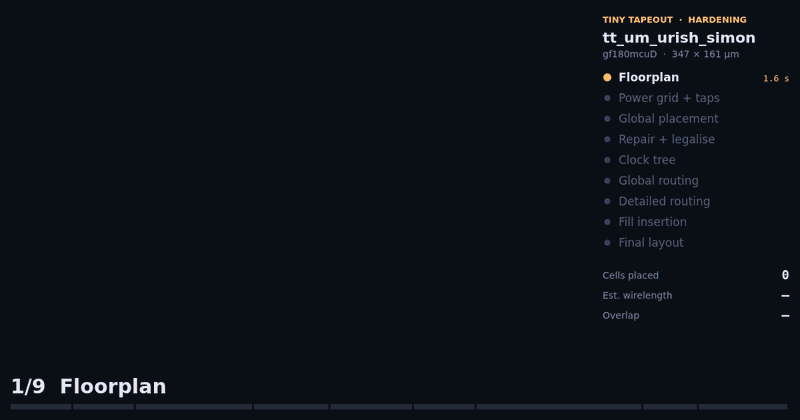

# Flow animation prototype

Builds an animation of a LibreLane run from its per-step DEF snapshots and logs (no OpenROAD needed).
Motion between snapshots and the layer-by-layer routing order are presentation, not tool output.

- `extract.py RUN_DIR -o scene.json`, then `render.js` (Playwright + ffmpeg) or the HTML player.
- `gf180-simon-player.html` is a self-contained interactive player (download and open).
